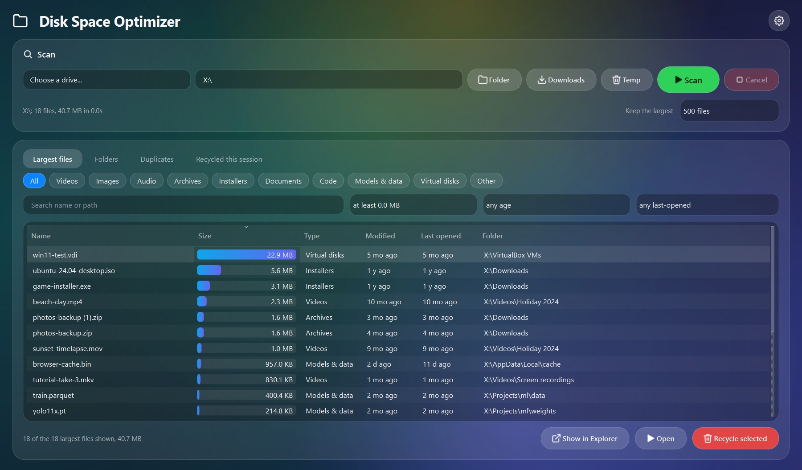

# Disk Space Optimizer

**Disk Space Optimizer** is a free, open-source disk space analyzer and cleaner for Windows (Python, PySide6). Scan any drive or folder, see the largest files and biggest folders with their size, type, modified date and last-opened date, filter by file type, age or name, find duplicate files, and free up storage safely: everything you remove goes to the Recycle Bin after a confirmation, and system folders are never touched. A fast, beautiful alternative to WinDirStat, TreeSize and WizTree style tools when you just want to find what is eating your disk and clean it up.



## Features

- **Scan any drive or folder.** Pick a drive from the list (with used/free space), browse to any folder, or use the one-click **Downloads** and **Temp** presets. Scans run in the background with live progress and can be cancelled at any time.
- **Largest files view.** The top N biggest files (500 by default) with a size bar, type, modified date, last-opened date and folder. Sort by any column.
- **Folders view.** Every folder with its total size and file count, biggest first. Expand to drill down, double-click to open in Explorer.
- **Filters.** Type chips (Videos, Images, Audio, Archives, Installers, Documents, Code, Models & data, Virtual disks, Other), text search over name or path, minimum size, "not modified for N days" and "not opened for N days". Totals for what is shown and what is selected.
- **Duplicate finder.** Groups files with identical content (same size, then SHA-256) and shows how much space the copies waste. One click selects all but the newest in each group.
- **Safe cleanup.** Selected files or folders are moved to the **Recycle Bin** (never permanently deleted) after a confirmation that shows the count, total size and the paths. Every recycled item is logged in the **Recycled this session** tab so you can find and restore it.
- **Protected locations.** The app refuses to recycle whole drives, the Windows, Program Files and ProgramData folders, core AppData folders, `pagefile.sys` and other boot files, your home folder, and its own install folder.
- **Reads only.** The scanner skips junctions, symlinks and unreadable folders and never modifies anything on its own.
- **Remembers your settings** (last path, filters, sort order, wallpaper) per user via `platformdirs`.
- **Command line mode** for quick reports: `DiskSpaceOptimizer.exe --cli D:\ --top 50 --folders --duplicates` (the CLI never deletes anything).

## Install

**Windows:** download `DiskSpaceOptimizer.exe` from the [latest release](https://github.com/PhantomAnas/Disk-Space-Optimizer/releases/latest) and run it. No installer, nothing else to set up.

**From source (Windows, macOS, Linux):**

```bash
git clone https://github.com/PhantomAnas/Disk-Space-Optimizer.git
cd Disk-Space-Optimizer
python -m venv .venv
.venv\Scripts\activate          # Linux/macOS: source .venv/bin/activate
pip install -e ".[dev]"         # or: pip install -r requirements.txt
disk-space-optimizer            # or: python launcher.py
```

## Usage

1. Choose a drive from the drop-down or press **Folder** to pick any folder, then **Scan**.
2. Use the type chips, search box, minimum size and age filters to narrow the list. Click a column header to sort.
3. Select files (Ctrl/Shift click for several), check the size total at the bottom, then **Recycle selected**. Confirm the dialog, which lists what will be moved.
4. Open the **Folders** tab to see where the space goes, or **Duplicates** to find identical copies.
5. Anything you recycled is listed under **Recycled this session**; **Open Recycle Bin** lets you restore it.

Command line:

```text
DiskSpaceOptimizer.exe --cli <path> [--top N] [--category Videos ...] [--min-size MB]
                              [--older-than DAYS] [--search TEXT] [--sort size|name|category|modified|accessed|folder]
                              [--folders] [--duplicates]
DiskSpaceOptimizer.exe --cli --drives
```

## Safety notes

- Nothing is ever permanently deleted by this app. Removal uses the operating system's Recycle Bin via `send2trash`, so you can restore anything.
- Every removal asks for confirmation and shows the exact paths, count and total size.
- Protected system locations are refused even if selected. Whole drives and the scanned root folder are never offered for deletion.
- The CLI mode is read-only.
- Files you recycle still occupy space until you empty the Recycle Bin.

## Development

```bash
pip install -e ".[dev]"
pytest                               # unit tests (scanner, filters, safety, settings, CLI)
python scripts/make_icon.py          # regenerate src/diskoptimizer/assets/icon.*
python scripts/screenshot.py         # regenerate docs/screenshot.png on a generated demo tree
pyinstaller diskoptimizer.spec       # build dist/DiskSpaceOptimizer.exe
```

Tagging `vX.Y.Z` builds the Windows exe in GitHub Actions and attaches it to a release.

## License

MIT. See [LICENSE](LICENSE).
